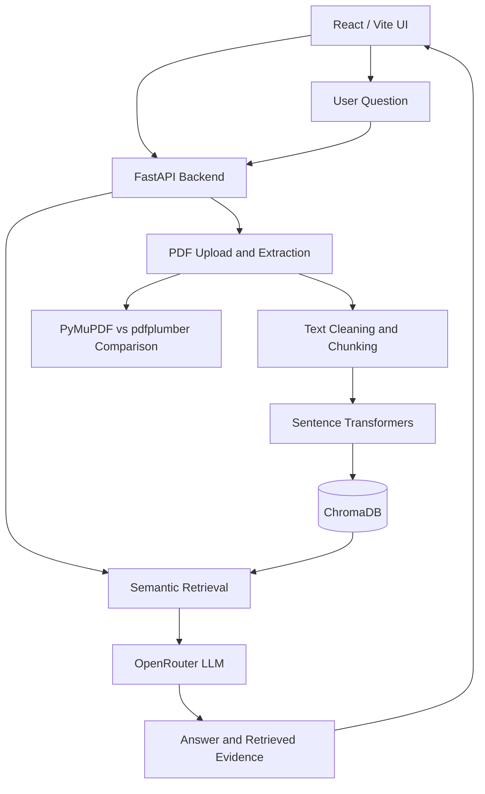

MediRAG AI
Clinical Guideline Intelligence Platform

Ask questions about clinical guideline PDFs using Retrieval-Augmented Generation (RAG), inspect retrieved evidence, compare PDF parsers, and explore hallucination risks.

[!IMPORTANT]
Research and educational use only. MediRAG AI is not a medical device and does not replace qualified clinical judgment. Always verify generated answers against the original guideline documents.

Overview
MediRAG AI is a full-stack application for exploring clinical guideline documents. It uses Retrieval-Augmented Generation (RAG) to retrieve relevant PDF passages before generating answers, with an emphasis on evidence traceability and understanding hallucinations.

The project also includes PDF text extraction, text cleaning, and a two-parser comparison workflow using PyMuPDF and pdfplumber to investigate common extraction problems.
Features
- Clinical PDF Upload: Ingest searchable clinical guideline PDFs.
- Semantic Retrieval: Split documents into chunks, generate Sentence Transformers embeddings, and search using ChromaDB.
- Evidence-Grounded Q&A: Supply retrieved passages as context to an OpenRouter-hosted language model.
- Source References: Display retrieved evidence when available.
- RAG vs. Baseline Comparison: Compare answers generated with and without retrieved guideline context.
- PDF Parser Comparison: Compare extraction output from PyMuPDF and pdfplumber.
- Text Cleaning: Investigate repeated headers and footers, page numbers, broken line wraps, hyphenated words, multi-column reading order, and tables.
- React Dashboard: Upload, manage, and query documents through a web interface.
[!NOTE]
Verification status: The backend /api/health endpoint returned HTTP 200 and the expected CORS header in local testing. Full PDF indexing, live LLM generation, frontend production build, and parser-quality evaluation have not yet been verified end to end.

Tech Stack
Layer	Technologies
Frontend	React, Vite, Lucide React
Backend	Python, FastAPI, Uvicorn
PDF Parsing	PyMuPDF, pdfplumber
Embeddings	Sentence Transformers
Vector Database	ChromaDB
LLM	OpenRouter (configurable model; example: openai/gpt-4o-mini)
Testing	pytest

System Architecture

Getting Started
Prerequisites
- Python 3.10 or newer, with a version compatible with the installed dependencies
- Node.js and npm
- An OpenRouter API key for live LLM requests
1. Clone the Repository
git clone https://github.com/YOUR_USERNAME/MediRAG-AI.git
cd MediRAG-AI
Replace YOUR_USERNAME with your GitHub username. The commands below assume the repository contains backend/ and frontend/ directories. If your frontend directory has a different name, adjust the commands accordingly.
2. Configure the Backend Environment
Create a .env file in the location expected by your backend configuration (typically backend/.env). If your project includes an .env.example, copy it first.

Windows PowerShell:
Copy-Item backend/.env.example backend/.env
macOS / Linux:
cp backend/.env.example backend/.env
If your example file is instead at the repository root, adjust the source path. Configure the relevant values:
OPENROUTER_API_KEY=your_openrouter_api_key
OPENROUTER_MODEL=openai/gpt-4o-mini
OPENROUTER_BASE_URL=https://openrouter.ai/api/v1
CORS_ORIGINS=http://127.0.0.1:5173,http://localhost:5173
MAX_UPLOAD_MB=15
[!WARNING]
Never commit .env, API keys, credentials, or patient-identifying data to GitHub. Confirm the variable names against your actual backend/app/core.py settings before running.

3. Start the Backend
Windows PowerShell:
cd backend
python -m venv .venv
.\.venv\Scripts\Activate.ps1
python -m pip install -r requirements.txt
python -m uvicorn app.main:app --host 127.0.0.1 --port 8001 --reload
macOS / Linux:
cd backend
python3 -m venv .venv
source .venv/bin/activate
python -m pip install -r requirements.txt
python -m uvicorn app.main:app --host 127.0.0.1 --port 8001 --reload
- Backend: http://127.0.0.1:8001
- API documentation: http://127.0.0.1:8001/docs
4. Start the Frontend
Open another terminal from the repository root:
cd frontend
npm install
Create frontend/.env:
VITE_API_URL=http://127.0.0.1:8001
Then run:
npm run dev
- Frontend: http://127.0.0.1:5173
If using the separately packaged SaaS frontend, run the commands from that folder instead and follow its bundled README.
API Endpoints
Method	Endpoint	Purpose
GET	/api/health	Service health and model configuration
GET	/api/documents	List indexed documents
DELETE	/api/documents/{document_id}	Remove a document
POST	/api/upload	Upload and ingest a PDF
POST	/api/chat	RAG question answering
POST	/api/compare	Compare baseline and RAG responses
POST	/api/v1/parse-and-clean	PDF extraction and cleaning workflow

Explore the request and response schemas at /docs while the backend is running.
PDF Parsing Experiment
The PDF extraction task is to compare at least two libraries on the same real, publicly available clinical guideline PDF:
1. PyMuPDF: Extract text and inspect page-level reading order.
2. pdfplumber: Extract text and inspect layout and table behavior.
3. Compare raw output for repeated headers/footers, page numbers, broken line wraps, hyphenated words, multi-column reading order, and tables.
4. Record findings with representative text excerpts and page numbers.
5. Clean extracted text and evaluate whether retrieval quality improves.
Parser Comparison Checklist
Criterion	PyMuPDF	pdfplumber
Header/footer repetition	To evaluate	To evaluate
Page numbers	To evaluate	To evaluate
Broken line wraps	To evaluate	To evaluate
Hyphenated words	To evaluate	To evaluate
Multi-column reading order	To evaluate	To evaluate
Tables	To evaluate	To evaluate

This table is a testing checklist, not a completed benchmark. Record actual measurements from both libraries on the same public PDF before reporting results.

Testing
Backend Health Check
curl http://127.0.0.1:8001/api/health
Backend Tests
From the repository root:
cd backend
python -m pytest -q
Frontend Production Build
From the repository root:
cd frontend
npm run build
Roadmap
- [x] Prepare FastAPI service and health endpoint
- [x] Verify local backend connectivity and CORS configuration
- [x] Prepare React frontend code
- [x] Prepare PDF parser comparison workflow in code
- [ ] Benchmark two parsers on a real public clinical guideline and document findings
- [ ] Verify PDF upload, embedding, retrieval, and citations end to end
- [ ] Verify frontend production build
- [ ] Add persistent chat history
- [ ] Add authentication, organization workspaces, and document-level permissions
- [ ] Add automated RAG evaluation metrics and CI
Security and Limitations
- This application is a development prototype, not a production-ready multi-tenant SaaS.
- Do not upload confidential or patient-identifying records without an appropriate security and compliance review.
- LLM answers may be incomplete, misleading, or incorrect even when retrieval is enabled.
- Live model requests require a valid OpenRouter API key.
- No open-source license has been specified. Add a LICENSE file if you intend to grant reuse permissions.
