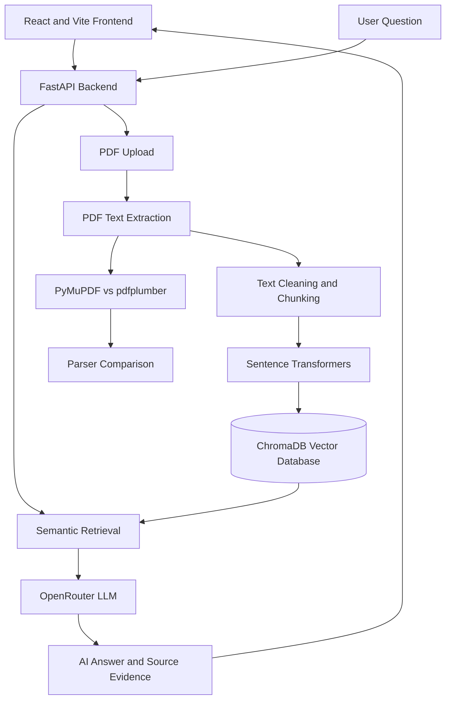

#  MediRAG AI

### Clinical Guideline Intelligence Platform

**MediRAG AI** is a full-stack Retrieval-Augmented Generation (RAG) application designed to analyze clinical guideline PDFs, retrieve relevant evidence, generate AI-powered answers, and compare responses with and without RAG.


---

##  Overview

MediRAG AI is an AI-powered clinical guideline intelligence platform that combines document processing, semantic search, and large language models.

The system allows users to upload clinical guideline PDFs and ask questions based on their contents.

Instead of relying only on the pretrained knowledge of a language model, MediRAG AI retrieves relevant information from uploaded documents before generating an answer.

This approach helps improve answer traceability and reduce unsupported AI-generated information.

The project also explores PDF text extraction, text cleaning, parser comparison, and hallucination analysis.

> **Disclaimer:** MediRAG AI is intended for educational and research purposes only. It is not a medical device and should not replace professional clinical judgment.


##  Key Features

- **PDF Upload:** Upload searchable clinical guideline documents.
- **Text Extraction:** Extract content from PDF documents using Python libraries.
- **Text Cleaning:** Identify and address common PDF parsing issues.
- **Document Chunking:** Divide extracted content into smaller searchable sections.
- **Semantic Embeddings:** Generate vector representations using Sentence Transformers.
- **Vector Database:** Store and retrieve document embeddings using ChromaDB.
- **AI Question Answering:** Generate answers using OpenRouter-supported language models.
- **Evidence Retrieval:** Display relevant source passages when available.
- **RAG vs Non-RAG Comparison:** Compare grounded and baseline model responses.
- **PDF Parser Comparison:** Compare PyMuPDF and pdfplumber extraction.
- **SaaS-Style Dashboard:** React-based interface for document management and AI interaction.


##  System Architecture




##  Technology Stack

| Category | Technology |
|---|---|
| Frontend | React.js, Vite |
| Backend | Python, FastAPI |
| API Server | Uvicorn |
| PDF Processing | PyMuPDF, pdfplumber |
| Embedding Model | Sentence Transformers |
| Vector Database | ChromaDB |
| LLM Integration | OpenRouter API |
| Language Model | Configurable, e.g. GPT-4o Mini |
| Testing | pytest |
| Development Tools | VS Code, Git, GitHub |


##  How RAG Works

MediRAG AI follows a five-step Retrieval-Augmented Generation pipeline.

### 1. Document Ingestion

The user uploads a clinical guideline PDF through the frontend.

The backend processes the uploaded file and extracts its text.

### 2. Text Chunking

The extracted content is divided into smaller chunks.

Chunking helps the system retrieve relevant information efficiently.

### 3. Embedding Generation

Sentence Transformers convert text chunks into numerical vectors called embeddings.

These embeddings represent the semantic meaning of the text.

### 4. Semantic Retrieval

When a user asks a question, the system searches ChromaDB for relevant document chunks.

The retrieved passages are provided as context to the language model.

### 5. Answer Generation

The language model generates a response using the retrieved context.

The application is designed to display supporting source evidence when available.


##  PDF Text Extraction and Cleaning

Clinical guideline PDFs often contain complex layouts that make text extraction difficult.

MediRAG AI investigates the following problems:

- Repeated page headers and footers
- Page numbers mixed with document text
- Broken line wraps
- Hyphenated words across lines
- Multi-column reading order
- Tables and structured information
- Irregular whitespace

### PDF Libraries

**PyMuPDF**

A Python library for extracting text, page information, and layout-related content from PDF documents.

**pdfplumber**

A Python library that provides text extraction and layout inspection capabilities, including table extraction.

### Parser Comparison

The project includes a workflow for comparing the output of both libraries on the same document.

| Evaluation Criterion | PyMuPDF | pdfplumber |
|---|---|---|
| Text extraction | To evaluate | To evaluate |
| Headers and footers | To evaluate | To evaluate |
| Page numbers | To evaluate | To evaluate |
| Broken line wraps | To evaluate | To evaluate |
| Hyphenated words | To evaluate | To evaluate |
| Multi-column layouts | To evaluate | To evaluate |
| Table extraction | To evaluate | To evaluate |

**Note:** Actual parser performance must be measured using the same real, publicly available clinical guideline PDF. The table above does not represent completed benchmark results.


##  Project Structure

The main application follows a frontend and backend architecture.

```text
MediRAG-AI/
│
├── backend/
│   ├── app/
│   │   ├── main.py
│   │   ├── core.py
│   │   ├── rag.py
│   │   ├── llm.py
│   │   └── services/
│   │       ├── pdf_extractor.py
│   │       ├── text_cleaner.py
│   │       └── compare_parsers.py
│   │
│   └── requirements.txt
│
├── frontend/
│   ├── src/
│   └── package.json
│
└── README.md
```

The exact frontend directory may differ when using the separately packaged SaaS frontend.


##  Installation and Setup

### Prerequisites

Make sure the following tools are installed:

- Python 3.10 or newer
- Node.js and npm
- Git
- OpenRouter API key

### Step 1: Clone Repository

```bash
git clone https://github.com/YOUR_USERNAME/MediRAG-AI.git
cd MediRAG-AI
```

Replace `YOUR_USERNAME` with your GitHub username.

### Step 2: Backend Setup

Open a terminal inside the backend folder.

```bash
cd backend
python -m venv .venv
```

Activate the virtual environment.

**Windows PowerShell:**

```powershell
.\.venv\Scripts\Activate.ps1
```

**Linux / macOS:**

```bash
source .venv/bin/activate
```

Install dependencies.

```bash
pip install -r requirements.txt
```

### Step 3: Configure Environment Variables

Create a `.env` file in the location expected by your backend configuration.

Example:

```env
OPENROUTER_API_KEY=your_openrouter_api_key
OPENROUTER_MODEL=openai/gpt-4o-mini
OPENROUTER_BASE_URL=https://openrouter.ai/api/v1
CORS_ORIGINS=http://127.0.0.1:5173,http://localhost:5173
MAX_UPLOAD_MB=15
```

Check the exact variable names against your installed backend configuration.

**Security:** Never upload `.env`, API keys, or sensitive clinical records to GitHub.

### Step 4: Run Backend

```bash
python -m uvicorn app.main:app --host 127.0.0.1 --port 8001 --reload
```

Backend URL:

http://127.0.0.1:8001

Swagger API Documentation:

http://127.0.0.1:8001/docs

### Step 5: Frontend Setup

Open a second terminal from the project root.

```bash
cd frontend
npm install
```

Create a `.env` file inside the frontend directory.

```env
VITE_API_URL=http://127.0.0.1:8001
```

Start the frontend:

```bash
npm run dev
```

Frontend URL:

http://127.0.0.1:5173

If using the separately packaged SaaS frontend, follow its included setup instructions.


##  API Endpoints

| Method | Endpoint | Description |
|---|---|---|
| GET | `/api/health` | Check backend service status |
| GET | `/api/documents` | List indexed documents |
| DELETE | `/api/documents/{document_id}` | Delete a document |
| POST | `/api/upload` | Upload and process PDF |
| POST | `/api/chat` | Ask RAG-based questions |
| POST | `/api/compare` | Compare RAG and baseline responses |
| POST | `/api/v1/parse-and-clean` | Extract and clean PDF text |

Detailed API request formats are available through FastAPI Swagger documentation.


##  Testing

### Backend Health Check

```bash
curl http://127.0.0.1:8001/api/health
```

Example successful response:

```json
{
  "status": "ok",
  "service": "MediRAG AI",
  "version": "2.0.0",
  "model": "openai/gpt-4o-mini"
}
```

### Backend Tests

```bash
cd backend
python -m pytest -q
```

### Frontend Production Build

```bash
cd frontend
npm run build
```

### Testing Status

- Backend health endpoint: Verified locally
- CORS configuration: Verified locally
- PDF extraction comparison: Pending benchmark validation
- End-to-end RAG retrieval: Pending verification
- Live LLM responses: Pending verification
- Frontend production build: Pending verification


##  RAG vs Non-RAG Comparison

One of the main objectives of MediRAG AI is to investigate whether retrieval improves the reliability of language model responses.

### Without RAG

The language model answers questions using its pretrained knowledge without receiving passages from the uploaded guideline.

### With RAG

The system retrieves relevant guideline passages and provides them to the language model before answer generation.

### Evaluation Criteria

- Factual correctness
- Relevance to the question
- Evidence support
- Hallucination detection
- Source traceability

This comparison helps identify the benefits and limitations of retrieval-augmented generation.


##  Development Roadmap

- [x] Plan the RAG architecture
- [x] Create the FastAPI backend
- [x] Implement backend API route definitions
- [x] Verify backend health endpoint
- [x] Resolve local CORS configuration
- [x] Prepare PDF extraction and parser comparison code
- [x] Prepare React frontend and SaaS-style redesign
- [ ] Benchmark PyMuPDF and pdfplumber on a real clinical guideline
- [ ] Verify PDF upload and text extraction end to end
- [ ] Verify document embeddings and ChromaDB retrieval
- [ ] Validate AI-generated answers and source references
- [ ] Complete frontend integration and production build testing
- [ ] Implement persistent chat history
- [ ] Add authentication and role-based access control
- [ ] Implement organization-based SaaS workspaces
- [ ] Add automated RAG evaluation metrics
- [ ] Configure GitHub Actions CI/CD
- [ ] Prepare production deployment


##  Security and Limitations

MediRAG AI is currently a development prototype.

It is not yet a production-ready multi-tenant SaaS application.

Important limitations:

- Authentication and organization-level permissions are not yet implemented.
- Sensitive or patient-identifying data should not be uploaded without an appropriate security review.
- AI-generated answers may contain errors even when RAG is enabled.
- Retrieved evidence should be checked against the original clinical guideline.
- Production security, monitoring, and compliance requirements still need to be addressed.


##  Project Objectives

The main objectives of this project are:

1. Understand and implement Retrieval-Augmented Generation.
2. Process and analyze clinical guideline PDF documents.
3. Compare PDF text extraction libraries.
4. Identify and clean common document parsing problems.
5. Implement semantic search using embeddings and ChromaDB.
6. Generate evidence-grounded answers using an LLM.
7. Compare RAG and non-RAG responses.
8. Investigate hallucinations and answer reliability.
9. Develop a modern full-stack AI application.
10. Extend the prototype toward a scalable SaaS architecture.

