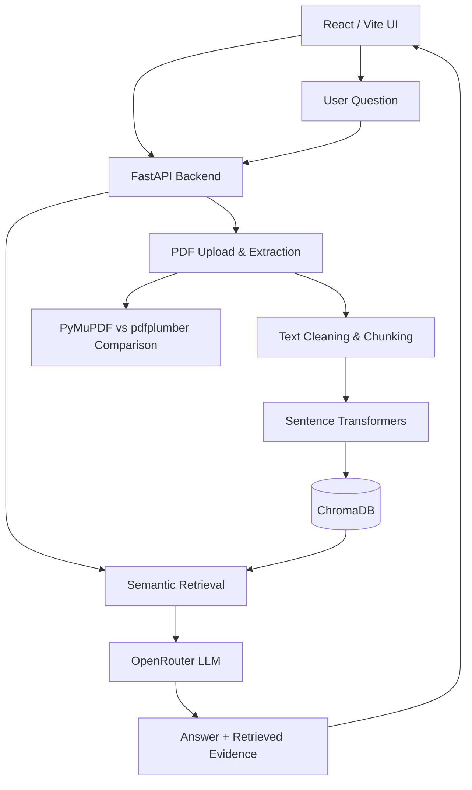

🩺 MediRAG AI
Clinical Guideline Intelligence Platform
Ask questions about clinical guideline PDFs with retrieval-augmented generation, inspect evidence, and compare PDF parsers.

[!IMPORTANT]
Research and educational use only. MediRAG AI is not a medical device and does not replace qualified clinical judgment. Always verify answers against original guideline documents.

Overview
MediRAG AI is a full-stack application for exploring clinical guideline documents. It uses Retrieval-Augmented Generation (RAG) to retrieve relevant PDF passages before generating an answer, with a focus on traceability and understanding hallucinations.

The project also includes PDF text extraction and cleaning, plus a two-parser comparison workflow using PyMuPDF and pdfplumber to investigate common extraction issues.
Features
- Clinical PDF upload  ingest searchable guideline documents.
- Semantic retrieval  chunk content, create embeddings with Sentence Transformers, and search with ChromaDB.
- Evidence-grounded Q&A  use retrieved passages as context for OpenRouter-hosted models.
- Source references  display retrieved evidence when available.
- RAG vs. baseline comparison  contrast grounded and ungrounded responses.
- PDF parser comparison  compare PyMuPDF and pdfplumber output.
- Text cleaning  investigate repeated headers and footers, page numbers, line wraps, hyphenation, multi-column reading order, and tables.
- React dashboard  upload, manage, and query documents.
Verification note: Backend /api/health returned HTTP 200 with the expected CORS header during local testing. Full PDF indexing, live LLM generation, frontend build, and parser-quality evaluation have not yet been independently verified end to end.
Tech Stack
Layer	Technologies
Frontend	React, Vite, Lucide React
Backend	Python, FastAPI, Uvicorn
PDF parsing	PyMuPDF, pdfplumber
Embeddings	Sentence Transformers
Vector database	ChromaDB
LLM	OpenRouter (configurable model; example: openai/gpt-4o-mini)
Testing	pytest

Architecture

Getting Started
Prerequisites
- Python 3.10 or newer (use a version supported by installed dependencies)
- Node.js and npm
- An OpenRouter API key for LLM requests
1. Clone the repository
git clone https://github.com/YOUR_USERNAME/MediRAG-AI.git
cd MediRAG-AI
Replace YOUR_USERNAME with your GitHub username. The commands below assume the repository contains backend/, frontend/, and .env.example at its root.
2. Configure environment
Copy the example environment file to .env in the project root:

Windows PowerShell:
Copy-Item .env.example .env
macOS / Linux:
cp .env.example .env
Edit .env:
OPENROUTER_API_KEY=your_openrouter_api_key
OPENROUTER_MODEL=openai/gpt-4o-mini
OPENROUTER_BASE_URL=https://openrouter.ai/api/v1
CORS_ORIGINS=http://127.0.0.1:5173,http://localhost:5173
MAX_UPLOAD_MB=15
Never commit .env, API keys, or patient-identifying data to GitHub.
3. Start the backend
Windows PowerShell:
cd backend
python -m venv .venv
.\.venv\Scripts\Activate.ps1
pip install -r requirements.txt
python -m uvicorn app.main:app --host 127.0.0.1 --port 8001 --reload
macOS / Linux:
cd backend
python3 -m venv .venv
source .venv/bin/activate
pip install -r requirements.txt
python -m uvicorn app.main:app --host 127.0.0.1 --port 8001 --reload
Backend: http://127.0.0.1:8001
API documentation: http://127.0.0.1:8001/docs
4. Start the frontend
Open another terminal from the repository root:
cd frontend
npm install
Create frontend/.env with:
VITE_API_URL=http://127.0.0.1:8001
Then:
npm run dev
Frontend: http://127.0.0.1:5173
If using the separately packaged SaaS frontend, use that folder instead of frontend/ and follow its bundled README. Do not assume both frontend variants have the same file layout.

API Endpoints
Method	Endpoint	Purpose
GET	/api/health	Service health and model configuration
GET	/api/documents	List indexed documents
DELETE	/api/documents/{document_id}	Remove a document
POST	/api/upload	Upload and ingest PDF
POST	/api/chat	RAG question answering
POST	/api/compare	Compare baseline and RAG responses
POST	/api/v1/parse-and-clean	PDF extraction and cleaning workflow

Explore request formats in /docs, which reflects the running backend version.
PDF Parsing Experiment
The PDF extraction task is to inspect the same publicly available clinical guideline PDF with at least two parsers:
1. PyMuPDF — extract text and inspect page-level reading order.
2. pdfplumber — extract text and inspect layout and table behavior.
3. Compare raw output for repeated headers/footers, page numbers, broken line wraps, hyphenated words, multi-column layout, and tables.
4. Record findings in a comparison table, with representative excerpts and page numbers.
5. Clean extracted text, then evaluate whether retrieval improves.
Criterion	PyMuPDF	pdfplumber
Header/footer repetition	To evaluate	To evaluate
Page numbers	To evaluate	To evaluate
Broken line wraps	To evaluate	To evaluate
Hyphenated words	To evaluate	To evaluate
Multi-column order	To evaluate	To evaluate
Tables	To evaluate	To evaluate

Do not treat this as a completed benchmark: measured results must come from actual extraction of the same real, publicly available PDF.
Testing
Backend health check:
curl http://127.0.0.1:8001/api/health
Run backend tests:
cd backend
python -m pytest -q
Build frontend:
cd frontend
npm run build
These commands are provided for reproducibility; no CI passing status is claimed.
Roadmap
- [x] FastAPI service and health endpoint
- [x] Local CORS configuration verified
- [x] React frontend code prepared
- [x] PDF parser comparison workflow implemented in code
- [ ] Benchmark two parsers on a real public clinical guideline and document findings
- [ ] Verify PDF upload, embedding, retrieval, and citations end to end
- [ ] Verify frontend production build
- [ ] Add persistent chat history
- [ ] Add authentication, organization workspaces, and document-level permissions
- [ ] Add automated RAG evaluation metrics and CI
Security & Limitations
- The current application is a development prototype, not a production multi-tenant SaaS.
- Do not upload confidential or patient-identifying records without an appropriate security and compliance review.
- LLM answers can be incomplete or incorrect even with retrieval.
- An OpenRouter API key is required for live model requests.
