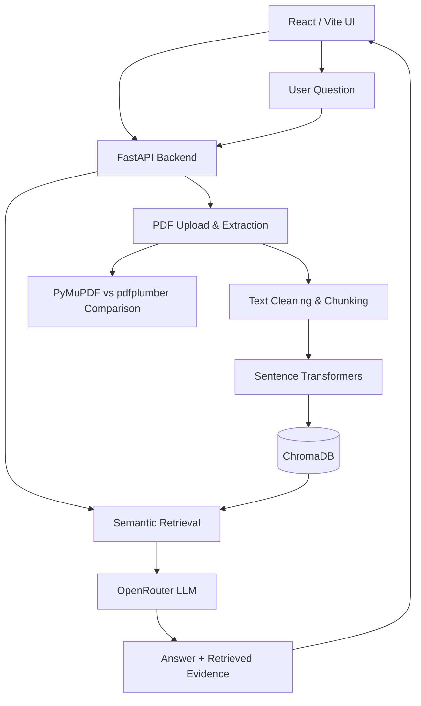

# MediRAG AI

> Clinical Guideline Intelligence Platform

Ask questions about clinical guideline PDFs with retrieval-augmented generation, inspect evidence, and compare PDF parsers.


---

> **IMPORTANT:** Research and educational use only. MediRAG AI is not a medical device and does not replace qualified clinical judgment. Always verify answers against original guideline documents.

---

## Overview

MediRAG AI is a full-stack application for exploring clinical guideline documents. It uses Retrieval-Augmented Generation (RAG) to retrieve relevant PDF passages before generating an answer, with a focus on traceability and understanding hallucinations.

The project also includes PDF text extraction and cleaning, plus a two-parser comparison workflow using PyMuPDF and pdfplumber to investigate common extraction issues.

---

## Features

- **Clinical PDF Upload:** Ingest searchable guideline documents.
- **Semantic Retrieval:** Chunk content, create embeddings with Sentence Transformers, and search with ChromaDB.
- **Evidence-Grounded Q&A:** Use retrieved passages as context for OpenRouter-hosted models.
- **Source References:** Display retrieved evidence when available.
- **RAG vs. Baseline Comparison:** Contrast grounded and ungrounded responses.
- **PDF Parser Comparison:** Compare PyMuPDF and pdfplumber output.
- **Text Cleaning:** Investigate repeated headers and footers, page numbers, line wraps, hyphenation, multi-column reading order, and tables.
- **React Dashboard:** Upload, manage, and query documents.

> **Verification Note:** Backend `/api/health` returned HTTP 200 with the expected CORS header during local testing. Full PDF indexing, live LLM generation, frontend build, and parser-quality evaluation have not yet been independently verified end to end.

---

## Tech Stack

| Layer | Technologies |
| :--- | :--- |
| **Frontend** | React, Vite, Lucide React |
| **Backend** | Python, FastAPI, Uvicorn |
| **PDF Parsing** | PyMuPDF, pdfplumber |
| **Embeddings** | Sentence Transformers |
| **Vector Database** | ChromaDB |
| **LLM** | OpenRouter *(configurable model; example: `openai/gpt-4o-mini`)* |
| **Testing** | pytest |

---

## Architecture


## Getting Started

### Prerequisites
- Python 3.10 or newer (use a version supported by installed dependencies)
- Node.js and npm
- An OpenRouter API Key for LLM requests

### 1. Clone the Repository
```bash
git clone [https://github.com/YOUR_USERNAME/MediRAG-AI.git](https://github.com/YOUR_USERNAME/MediRAG-AI.git)
cd MediRAG-AI
Replace YOUR_USERNAME with your GitHub username. The commands below assume the repository contains backend/, frontend/, and .env.example at its root.

2. Configure Environment
Copy the example environment file to .env in the project root:

Windows PowerShell:

PowerShell
Copy-Item .env.example .env
macOS / Linux:

Bash
cp .env.example .env
Edit .env:

Code snippet
OPENROUTER_API_KEY=your_openrouter_api_key
OPENROUTER_MODEL=openai/gpt-4o-mini
OPENROUTER_BASE_URL=[https://openrouter.ai/api/v1](https://openrouter.ai/api/v1)
CORS_ORIGINS=[http://127.0.0.1:5173](http://127.0.0.1:5173),http://localhost:5173
MAX_UPLOAD_MB=15
Warning: Never commit .env, API keys, or patient-identifying data to GitHub.

3. Start the Backend
Windows PowerShell:

PowerShell
cd backend
python -m venv .venv
.\.venv\Scripts\Activate.ps1
pip install -r requirements.txt
python -m uvicorn app.main:app --host 127.0.0.1 --port 8001 --reload
macOS / Linux:

Bash
cd backend
python3 -m venv .venv
source .venv/bin/activate
pip install -r requirements.txt
python -m uvicorn app.main:app --host 127.0.0.1 --port 8001 --reload
Backend URL: http://127.0.0.1:8001

API Documentation: http://127.0.0.1:8001/docs

4. Start the Frontend
Open another terminal from the repository root:

Bash
cd frontend
npm install
Create frontend/.env with:

Code snippet
VITE_API_URL=[http://127.0.0.1:8001](http://127.0.0.1:8001)
Then start the development server:

Bash
npm run dev
Frontend URL: http://127.0.0.1:5173

If using the separately packaged SaaS frontend, use that folder instead of frontend/ and follow its bundled README.

API Endpoints
Method	Endpoint	Purpose
GET	/api/health	Service health and model configuration
GET	/api/documents	List indexed documents
DELETE	/api/documents/{document_id}	Remove a document
POST	/api/upload	Upload and ingest PDF
POST	/api/chat	RAG question answering
POST	/api/compare	Compare baseline and RAG responses
POST	/api/v1/parse-and-clean	PDF extraction and cleaning workflow
Explore detailed request formats in /docs on your running backend.

PDF Parsing Experiment
The PDF extraction task is to inspect the same publicly available clinical guideline PDF with at least two parsers:

PyMuPDF — extract text and inspect page-level reading order.

pdfplumber — extract text and inspect layout and table behavior.

Compare raw output for repeated headers/footers, page numbers, broken line wraps, hyphenated words, multi-column layout, and tables.

Record findings in a comparison table, with representative excerpts and page numbers.

Clean extracted text, then evaluate whether retrieval improves.

Criterion	PyMuPDF	pdfplumber
Header/footer repetition	To evaluate	To evaluate
Page numbers	To evaluate	To evaluate
Broken line wraps	To evaluate	To evaluate
Hyphenated words	To evaluate	To evaluate
Multi-column order	To evaluate	To evaluate
Tables	To evaluate	To evaluate
Do not treat this as a completed benchmark: measured results must come from actual extraction of the same real, publicly available PDF.

Testing
Backend Health Check:

Bash
curl [http://127.0.0.1:8001/api/health](http://127.0.0.1:8001/api/health)
Run Backend Tests:

Bash
cd backend
python -m pytest -q
Build Frontend:

Bash
cd frontend
npm run build
Roadmap
[x] FastAPI service and health endpoint

[x] Local CORS configuration verified

[x] React frontend code prepared

[x] PDF parser comparison workflow implemented in code

[ ] Benchmark two parsers on a real public clinical guideline and document findings

[ ] Verify PDF upload, embedding, retrieval, and citations end to end

[ ] Verify frontend production build

[ ] Add persistent chat history

[ ] Add authentication, organization workspaces, and document-level permissions

[ ] Add automated RAG evaluation metrics and CI

Security & Limitations
The current application is a development prototype, not a production multi-tenant SaaS.

Do not upload confidential or patient-identifying records without an appropriate security and compliance review.

LLM answers can be incomplete or incorrect even with retrieval.

An OpenRouter API key is required for live model requests.

